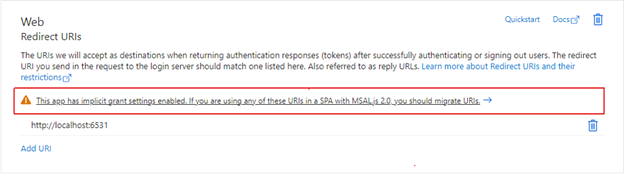
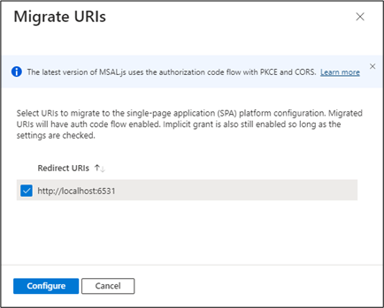

# Configuring Azure integration

Windows Admin Center supports several optional features that integrate with Azure services. [Learn about the Azure integration options available with Windows Admin Center.](./index.md)

Register the Windows Admin Center gateway with Azure to use Microsoft Entra authentication for gateway access and create Azure resources through Windows Admin Center. Starting with Windows Admin Center version 2611, you can register by using Azure role-based access control (Azure RBAC) without creating a Microsoft Entra application or obtaining tenant-wide administrator consent. Alternatively, you can use your own Microsoft Entra application with the `WACAdmin` and `WACUser` app roles. Both models use a Microsoft sign-in window, so you don't need to configure redirect URIs for the gateway URL, port, or certificate.

This article shows you how to choose a registration model, register the gateway, and manage registration and sign-in.

> [!IMPORTANT]
> If you're updating from a version earlier than 2611, your existing Azure registration isn't carried over. After the update, the gateway is unregistered and all users are signed out of Azure. Re-register the gateway by using the steps in this article. If you previously used your own Microsoft Entra app, you can select it again during registration - you don't need to create a new one.

## Choose a registration model

Each gateway uses one registration model at a time. Pick the one that matches how you want to control who can perform Azure operations in Windows Admin Center.

| | Azure RBAC (recommended) | Windows Admin Center RBAC application |
|---|---|---|
| **Best for** | Most organizations; the fastest way to get started | Organizations that want to gate Azure access in Windows Admin Center with their own app roles |
| **Microsoft Entra app** | None required. Windows Admin Center uses a Microsoft-provided app. | Your own app registration, which must include `WAC` in its display name |
| **Who can sign in** | Any user in the registered tenant | Users assigned the `WACAdmin` or `WACUser` app role |
| **What governs Azure access** | Each user's Azure role assignments | Your app roles, plus each user's Azure role assignments on the resources they access |
| **Setup before registering** | None | Create the app and its roles, and enable public client flows |
| **Supported in** | Administration Mode and Virtualization Mode | Administration Mode only |

You can also sign in to Azure *without* registering the gateway. This option is useful for a quick, single-administrator setup, but it doesn't restrict access by tenant or app role. For more information, see [Sign in without registering](#sign-in-without-registering-administration-mode).

## Prerequisites for Azure registration in Windows Admin Center

- You must be a Windows Admin Center gateway administrator to register or unregister the gateway. Learn more about [Windows Admin Center user and administrator permissions](../configure/user-access-control.md#gateway-access-role-definitions).
- You need a Microsoft Entra account in the tenant you want to register the gateway with.
- To use the Windows Admin Center RBAC application model, you need permission to create or manage app registrations in your tenant (or an existing app that meets the [requirements for your Microsoft Entra app](#prepare-your-own-microsoft-entra-app)).

> [!NOTE]
> If you enable Microsoft Defender Application Guard for your browser, you can't register Windows Admin Center with Azure or sign in to Azure.

## Register your gateway with Azure

Registration works differently depending on which mode your gateway runs in. Select the tab for your mode to see the steps.

# [Administration Mode](#tab/administration-mode)

The first time you try to use an Azure integration feature, Windows Admin Center takes you to the registration page. You can also get there directly:

1. In Windows Admin Center, select the **Settings** gear, and then under **Gateway**, select **Register**.
1. Under **Register with access control (recommended)**, open the **Access governance method** dropdown and choose one of the following:
   - **Azure RBAC** – Access is managed with Azure role assignments.
   - **WACAdmin and WACUser roles in your own application** – Access is managed with roles defined in your own app registration. If you select this option, choose your app from the list. Only applications whose display name contains `WAC` are listed.
1. Select **Register**. The button stays unavailable until you choose a governance method.
1. In the Microsoft sign-in window that opens, pick your account and confirm the sign-in.
1. When registration finishes, the **Access control** card shows **Registered with access control**, and you're signed in to Azure.

Registering also signs you in, so you can start using Azure features right away.

If **Register** is unavailable after you make a selection, check the following:

- **You aren't a gateway administrator.** Only gateway administrators can register the gateway.
- **You're signed in without registration.** Sign out of the current Azure session first. The page shows: *To configure access control, sign out of the current Azure session.*

# [Virtualization Mode](#tab/virtualization-mode)

Virtualization Mode keeps things streamlined: there's no separate registration page, and the gateway always registers with **Azure RBAC**.

1. In Windows Admin Center, select the Azure account control.
1. If a gateway administrator didn't register the gateway yet and you're a Windows Admin Center gateway administrator, select **Sign in and register**. This action registers the gateway with your tenant and signs you in, all in one step.
1. Pick your account in the Microsoft sign-in window and confirm.

After the gateway is registered, other users see only **Sign in**, and they're asked to sign in to the registered tenant.

> [!NOTE]
> In Virtualization Mode, users can't sign in to Azure until a Windows Admin Center gateway administrator registers the gateway. If you aren't a gateway administrator and no Windows Admin Center gateway administrator registered the gateway, ask a Windows Admin Center gateway administrator to register it.

---

## Prepare your own Microsoft Entra app

This section applies to Administration Mode only. Skip it if you're using Azure RBAC.

To use the Windows Admin Center RBAC application model, your app registration must:

1. **Include `WAC` in its display name.** The app picker only lists apps whose display name contains `WAC`. For example, *Contoso-WAC-Gateway*.
1. **Define two app roles:** `WACAdmin` and `WACUser`. Assign these roles to the users and groups who should be able to use Azure features in Windows Admin Center.
1. **Allow public client flows.** In the Microsoft Entra admin center, go to **Identity** > **Applications** > **App registrations**, select your app, select **Authentication**, and set **Allow public client flows** to **Yes**.

For steps to create app roles and assign users, see [Add app roles to your application](/entra/identity-platform/howto-add-app-roles-in-apps).

## Sign in without registering (Administration Mode)

In Administration Mode, a gateway administrator can sign in to Azure without registering the gateway. In this state:

- The **Azure session** card shows that you're signed in, with **Authorization mode: Personal**.
- Only gateway administrators can sign in.
- Access isn't restricted to a specific tenant or app role.

To set up access control later, sign out of the current Azure session, and then follow the steps in [Register your gateway with Azure](#register-your-gateway-with-azure).

## View and manage your registration

After registration, the **Access control** card shows the current configuration:

- **Registration model** – **Azure RBAC** or **Windows Admin Center RBAC application**.
- **Tenant** and **Tenant ID** – For Azure RBAC registrations. If the tenant's display name isn't available (for example, for gateways registered before this was captured), only the tenant ID appears.
- **App name** and **App ID** – For Windows Admin Center RBAC application registrations.

Select **Manage registration** to see more details, such as the Azure cloud, and a **View in Azure** link.

The **Azure session** card shows who's signed in and how the session is authorized:

| Authorization mode | Meaning |
|---|---|
| Personal | The gateway isn't registered. Only gateway administrators can sign in. |
| Tenant-locked | The gateway is registered with Azure RBAC. Sign-in is limited to the registered tenant. |
| WAC RBAC | The gateway is registered with your own application. Sign-in requires the `WACAdmin` or `WACUser` role. |

### Change or remove a registration

To switch models or move to a different tenant or app, unregister the gateway and register it again.

> [!WARNING]
> Unregistering removes the gateway's registration and every user's stored Azure sign-in. All users are signed out of Azure and must sign in again after you re-register.

## Use Microsoft Entra authentication for gateway access

You can require users to [authenticate with Microsoft Entra ID](../configure/user-access-control.md#azure-active-directory) before they can open Windows Admin Center. This setting, on the **Access** page of gateway settings, is available only when the gateway is registered with the **Windows Admin Center RBAC application** model. If the gateway is registered with Azure RBAC, the setting is unavailable—unregister and re-register with your own application to use it.

## Azure sign-in session behavior in Windows Admin Center

- **Sign-in is per browser.** Your Azure sign-in is stored securely on the gateway and can only be unlocked by the browser you signed in with. If you open Windows Admin Center in a different browser or on a different machine, you're asked to sign in again.
- **Sessions last up to about 90 days.** You won't be asked to sign in again unless you sign out, your browser data is cleared, the session expires, or an administrator unregisters the gateway.

## Troubleshoot Azure registration and sign-in

### Register is unavailable

See the checklist in [Register your gateway with Azure](#register-your-gateway-with-azure). You must be a gateway administrator, and you can't register while signed in without registration.

### My app doesn't appear in the app picker

Make sure the app's display name contains `WAC`, and that you're signed in to the tenant where the app is registered.

### "You don't have access" after signing in

- **Azure RBAC:** Confirm you signed in with an account in the registered tenant. Accounts from other tenants are rejected.
- **Windows Admin Center RBAC application:** Confirm the account is assigned the `WACAdmin` or `WACUser` role on the app.

If you can sign in but an Azure feature fails, check that the account has the Azure role assignments required by that feature on the target subscription or resource group.

### I was signed out after updating Windows Admin Center

This sign-out behavior is expected when updating from a version earlier than 2611. Re-register the gateway. If you previously used your own app, select it from the app picker during registration.

### Errors on versions earlier than 2611

If you're running a version earlier than 2611, you might see redirect URI errors, such as *The redirect URI doesn't match the URIs configured for this application* or *Cross-origin token redemption is permitted only for the 'Single-Page Application' client type*. Update to the latest version of Windows Admin Center and re-register, which doesn't use redirect URIs. If you can't update yet, see [Azure registration in versions earlier than 2611](#azure-registration-in-versions-earlier-than-2611).

## Azure registration in versions earlier than 2611

The following guidance applies to Windows Admin Center versions earlier than 2611, which register the gateway by creating or using a Microsoft Entra app with redirect URIs.

### Register your gateway (versions earlier than 2611)

The first time you try to use an Azure integration feature in Windows Admin Center, you're prompted to register the gateway to Azure. You can also register the gateway by going to the **Azure** tab in Windows Admin Center Settings. Only Windows Admin Center gateway administrators can register the Windows Admin Center gateway with Azure. [Learn more about Windows Admin Center user and administrator permissions](../configure/user-access-control.md#gateway-access-role-definitions).

The guided in-product steps create a Microsoft Entra app in your directory, which allows Windows Admin Center to communicate with Azure. To view the Microsoft Entra app that is automatically created, go to the **Azure** tab of Windows Admin Center settings. The **View in Azure** hyperlink lets you view the Microsoft Entra app in the Azure portal.

The Microsoft Entra app created is used for all points of Azure integration in Windows Admin Center, including [Microsoft Entra authentication to the gateway](../configure/user-access-control.md#azure-active-directory). Windows Admin Center automatically configures the permissions needed to create and manage Azure resources on your behalf:

- Microsoft Graph
    - Application.ReadWrite.All
- Azure Service Management
    - user_impersonation

<a name='manual-azure-ad-app-configuration'></a>

### Manual Microsoft Entra app configuration

If you want to configure a Microsoft Entra app manually, rather than using the Microsoft Entra app that Windows Admin Center automatically creates during the gateway registration process, follow these steps:

1. Grant the Microsoft Entra app the required API permissions listed earlier. To do this, go to your Microsoft Entra app in the Azure portal. Go to the Azure portal > **Microsoft Entra ID** > **App registrations** > select the Microsoft Entra app you want to use. Then, go to the **API permissions** tab and add the required API permissions.
1. Add the Windows Admin Center gateway URL to the reply URLs (also known as the redirect URIs). Go to your Microsoft Entra app, and then go to **Manifest**. Find the `replyUrlsWithType` key in the manifest. Within the key, add an object containing two keys: `url` and `type`. The `url` key should have a value of the Windows Admin Center gateway URL, appending a wildcard at the end. The `type` key should have a value of `Web`. For example:

    ```json
    "replyUrlsWithType": [
            {
                    "url": "http://localhost:6516/*",
                    "type": "Single-Page Application"
            }
    ],
    ```

### The redirect URI doesn't match the URIs configured for this application

If you recently migrated your data from an older version of Windows Admin Center to Windows Admin Center version 2410, your redirect URIs might be misconfigured. This misconfiguration can happen if you didn't complete the Azure Registration step in the migration wizard. This misconfiguration occurs because Windows Admin Center changed the way it performs authentication based on [general Microsoft guidance](/entra/identity-platform/v2-oauth2-implicit-grant-flow#prefer-the-auth-code-flow). Where it previously used the implicit grant flow, it now uses the authorization code flow.

You must add two redirect URIs to the Single-Page Application (SPA) platform. An example of these redirect URIs is:

```
https://myMachineName.domain.com:6600
https://myMachineName.domain.com:6600/signin-oidc
```

In this example, the numerical value refers to the port referenced in your Windows Admin Center installation.

All redirect URIs for Windows Admin Center must contain:

- The Fully Qualified Domain Name (FQDN) or hostname of your gateway machine, with no mention of localhost
- The HTTPS prefix, not HTTP

[Learn how to reconfigure your redirect URIs](/troubleshoot/entra/entra-id/app-integration/error-code-AADSTS50011-redirect-uri-mismatch).

After adding the proper redirect URIs, clean up old, unused redirect URIs.

### Cross-origin token redemption permitted only for single-page application

If you recently updated your Windows Admin Center instance to a newer version and previously registered your gateway with Azure, you might encounter an error stating "cross-origin token redemption is permitted only for the 'Single-Page Application' client type" when signing into Azure. This error appears because Windows Admin Center changed the way it performs authentication based on [general Microsoft guidance](/entra/identity-platform/v2-oauth2-implicit-grant-flow#prefer-the-auth-code-flow). Where it previously used the implicit grant flow, it now uses the authorization code flow.

If you want to continue using your existing app registration for your Windows Admin Center application, use [Microsoft Entra admin center](https://entra.microsoft.com/) to update the registration's redirect URIs to the Single-Page Application (SPA) platform. This change enables the authorization code flow with Proof Key for Code Exchange (PKCE) and cross-origin resource sharing (CORS) support for applications that use that registration.

Follow these steps for application registrations that are currently configured with **Web** platform redirect URIs:

1. Sign in to the [Microsoft Entra admin center](https://entra.microsoft.com/).
1. Navigate to **Identity** > **Applications** > **App registrations**, select your application, and then select **Authentication**.
1. In the **Web** platform tile under **Redirect URIs**, select the warning banner indicating that you should migrate your URIs.

1. Select the redirect URI for your application and then select **Configure**. These redirect URIs now appear in the **Single-page application** platform tile, showing that CORS support with the authorization code flow and PKCE is enabled for these URIs.


Instead of updating existing URIs, you can create a new application registration for your gateway. App registrations that are newly created for Windows Admin Center through the gateway registration flow create Single-Page Application platform redirect URIs.

If you can't migrate your application registration's redirect URIs to use auth code flow, you can continue to use the existing application registration as is. To do so, you must unregister your Windows Admin Center gateway and re-register with the same application registration ID.
