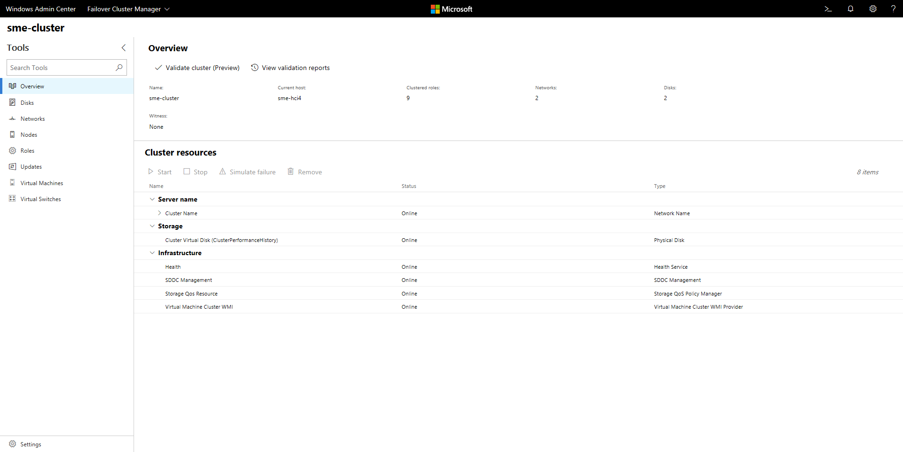

# Manage failover clusters by using Windows Admin Center

Failover Clustering groups multiple servers into a fault-tolerant cluster so that applications and services can remain available if a server fails. Windows Admin Center provides a central interface for managing these clusters, which helps you monitor and maintain cluster resources without managing each node separately.

This article shows you how to add a failover cluster to Windows Admin Center and lists the tools available for managing cluster resources, storage, networks, nodes, roles, virtual machines, and virtual switches. The guidance applies only to failover cluster connections in Windows Admin Center Administration Mode. To manage virtualization clusters in Virtualization Mode, use the virtualization fabric and resource hierarchy.

> [!Tip]
> New to Windows Admin Center?
> [Download or learn more about Windows Admin Center](../overview.md).

## Add a failover cluster to Windows Admin Center

1. Under **All Connections**, select **+ Add**.

2. Select **Server clusters** as the connection type.

3. Enter the name of the cluster. If you're prompted, enter the credentials to use.

4. Choose whether to add the cluster nodes as individual server connections in Windows Admin Center.

5. Select **Add** to finish.

The cluster is added to your list of connections on the **Overview** page. Select it to connect to the cluster.

> [!NOTE]
> You can also manage hyper-converged clusters by adding the cluster as a [hyper-converged cluster connection](manage-hyper-converged.md) in Windows Admin Center.

## Tools for managing failover clusters

The following areas of Windows Admin Center represent tools that are available for failover cluster connections:

| Area | Description |
| ---- | ----------- |
| **Overview** | View failover cluster details and manage cluster resources. |
| **Disks** | View cluster shared disks and volumes. |
| **Networks** | View networks in the cluster. |
| **Nodes** | View and manage cluster nodes. |
| **Roles** | Manage cluster roles or create an empty role. |
| **Updates** | Manage Cluster-Aware Updating (requires [CredSSP](../understand/faq.yml#does-windows-admin-center-use-credssp-)). |
| **Virtual Machines** | View and manage [virtual machines](manage-virtual-machines.md). |
| **Virtual Switches** | View and manage virtual switches. |
